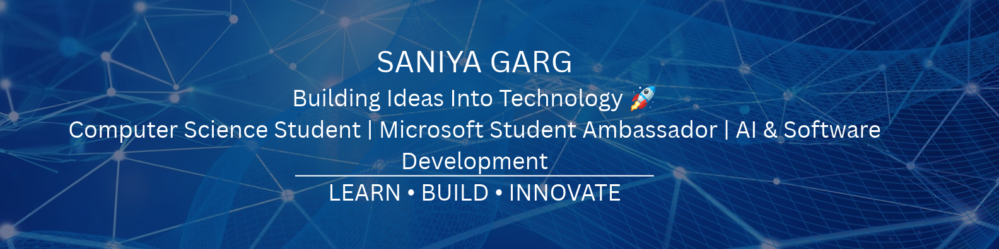

# Hi, I'm Saniya Garg 👋

### Building Ideas Into Technology 🚀

Computer Science Student | Microsoft Student Ambassador

---

## 👩‍💻 About Me

- 🎓 B.Tech Computer Science Student.
- 💙 Microsoft Student Ambassador (Associate).
- 💻 Interested in Software Engineering.
- 🤖 Exploring Generative AI and AI Agents.
- ☁️ Learning Microsoft Azure and Cloud Technologies.
- 🚀 Building projects that solve real-world problems.

## 🛠️ Technologies & Tools

  

## 🚀 Featured Projects

### 1. Smart Classroom Management System
A web-based system for classroom availability,
timetable management and rescheduling.

### 2. AI Agent Projects
Exploring AI agents and workflows using Microsoft Foundry.

## 🏆 Achievements

- Microsoft Student Ambassador – Associate
- GitHub Foundations Certification

## 📊 GitHub Statistics

## 🤝 Connect With Me

- LinkedIn: www.linkedin.com/in/saniya-garg-324b23397

- GitHub: https://github.com/saniyagarg8002

### ✨ Always Learning | Always Building ✨

